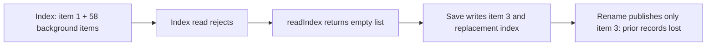

# Shared library conformance

The unchanged route does not conform to the ratified safety contract. The
model and all protected inputs are unchanged. `conformance.ts` imports the
production handlers and supplies an in-memory `fs/promises` implementation,
deterministic IDs/time, two tracked slots beside 58 fixed background items,
and at most one injected filesystem failure per run.

The latest gate run completed the driver and passed pins, design, witness,
known-bug, and trace-initialization checks. Conformance failed. Two of the four
gate runs were used; the first exposed a driver syntax incompatibility that
was corrected before the second run.

## Gate counterexample: discarded index after a read failure

The gate reported this transition in the `upsert` scenario, with request 1
holding the lock:

| Observation | Before | After |
| --- | --- | --- |
| `pc` | `read` | `blob-mkdir` |
| `index` | `<<1>>` | `<<1>>` |
| `loaded` | `<<>>` | `<<>>` |
| `target` | `<<>>` | `<<3>>` |
| `failures`, `failedAt` | `0`, `none` | `1`, `read` |
| `protected` | `{}` | `{1}` |
| `background.targetListed` | `TRUE` | `FALSE` |

The published files have not changed at this observation. The rejected step
is the handler continuing after the read error with an empty replacement
basis, exactly the ratified `DiscardIndexOnReadError` action. In
`app/api/library/route.ts:86–91`, `readIndex` catches the error and returns `[]`.
The subsequent index publication loses the previously listed background
records (and the protected tracked item), violating
`ReadFailurePreservesItems`. The gate's known-bug check independently confirms
that adding this action to `Next` reaches that invariant violation.

## Removal ordering in the unchanged source

The upsert loop at line 147, trimming loop at line 150, delete-all loop at
line 173, and delete-one removal at line 178 all remove blobs **before**
`writeIndex` publishes the new index. At the first successful removal, the
old index still lists the deleted blob. That directly violates
`ListedItemsHaveBytes`, even if every later operation succeeds. A subsequent
write/rename failure, or a removal that takes effect before rejecting, can
leave that state persistent. This is the ratified `RemoveBeforePublishing`
bug; its invariant violation also passed the gate's known-bug check.

The driver records every writer filesystem completion/rejection separately,
so these intermediate states are retained rather than hidden by a later
successful response. It writes exactly the requested number of runs and
steps to `INVARIANT_TRACES`, and writes operation/response evidence alongside
that file with the suffix `.observations.json`.

The gate reports its first disallowed transition; its displayed concrete
counterexample is the read-error transition above. The removal finding is
also directly visible in the source and covered by the model's known-bug
check. No passing conformance claim is made for the remaining statements.
Accepting either behavior in `Next` would break a ratified invariant, so the
model has not been weakened. Any implementation fix belongs in the separate
change requested by the issue discussion.
